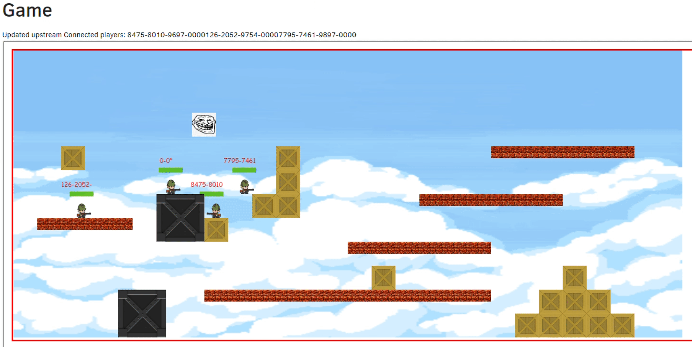

# SWAP 2021 - Soldat Hackaton

[](https://www.youtube.com/watch?v=iRQiGY0veIs)

Demo se zvuky: [https://www.youtube.com/watch?v=iRQiGY0veIs](https://www.youtube.com/watch?v=iRQiGY0veIs)

# **Soldat Nevolution**

- Relativně realtime
- Střílení myší
- "Náhodně" generovaná mapa
- Respawn hráče
- Bonusy (Nesmrtelnost, Zvýšená rychlost, Freeze hráčů, Přidání života, Zrychlení hráče)
- Herní módy (Time limit, Score limit)
- ELO + LeaderBoard
- Audio grafický masterpiece (Life bar + id hráče, Stav hráče)

**Technické overview**

-   Java
-   HTML Canvas (nestandard)
- SSE (nestandard)
- Posílání stavu + speciálních event
- Klient posílá pohyb (neposílá souřadnice - výpočet na serveru)
- Univerzální engine
- Modulární koncept
- Snadná rozšiřitelnost (intefaces všude)
- InMemory místnosti (inMemory DAO)
- Ukládáme pouze uuIdentity + score

## Architektura enginu

```
GameEngineRegistry          jeden na server; vlastní sdílený scheduler a živé instance her
  └─ GameEngine             jedna na místnost; tick loop, buffer vstupů, autoritativní stav
       └─ IRule<STATE,MOVE> vlastní hra (@Service("soldat") / @Service("bulanci"))
```

Tick (výchozí 50 ms, tedy 20 ticků/s):

```
nextState = rule.getNextGameState(currentState, drainInbox())
```

Pravidlo v jednom ticku: aplikuje vstupy → posune fyziku každého hráče **právě jednou** →
spadne a usadí bonusy → posune munici → vyhodnotí konec zápasu.

Všechny herní doby (skok, respawn, dobíjení, trvání bonusů, konec zápasu) se počítají
v **ticích**, ne podle hodin. Simulace je proto deterministická, nezávislá na vytížení
serveru a testovatelná bez čekání.

**Vlákna**
- Jeden sdílený `ScheduledExecutorService` pro všechny hry (dřív se zakládal nový executor
  při každém startu hry a nikdy se nezavíral).
- Vstupy putují z HTTP vláken do tick vlákna přes `ConcurrentLinkedQueue` — bez zámku
  a bez ztráty tahu při souběhu.
- SSE se rozesílá per místnost, mimo tick vlákno, každý odběratel má vlastní frontu.
  Pomalý klient tak nebrzdí simulaci ostatních.

**Ladicí parametry** (`application.properties`)

| Klíč | Výchozí | Význam |
| --- | --- | --- |
| `game.engine.tickMillis` | 50 | perioda simulace; mění rychlost celé hry |
| `game.engine.schedulerThreads` | 4 | sdílený pool ticků |
| `game.broadcast.dispatcherThreads` | 8 | vlákna pro zápis do SSE |
| `game.defaultGame` | soldat | hra pro nově založené místnosti |
| `game.engine.idleRoomMillis` | 900000 | jak dlouho smí místnost bez zápasu ležet ladem, než ji úklid zruší |
| `game.engine.reclaimIntervalMillis` | 60000 | jak často úklid běží (na stejném tick poolu, ne na vlastním) |
| `game.room.moveSubmissionsPerSecond` | 100 | strop odeslání tahů na hráče a místnost; legitimní klient posílá 20/s |
| `game.room.disconnectGraceMillis` | 15000 | odklad, než zavřený stream stojí hráče místo v zápase |

**Parametry zápasu** (`gameInstance/startGame` → `gameParameters`)

| Klíč | Výchozí | Význam |
| --- | --- | --- |
| `gameMode` | TIME_LIMIT | `TIME_LIMIT` nebo `SCORE_ACHIEVED` |
| `gameModeSecondLimit` | 120 | délka zápasu v sekundách |
| `gameModeStopAtScore` | 5 | cílové skóre |
| `initialLives` | 5 | počet životů hráče |
| `playerCollision` | true | zda se hráči navzájem blokují |
| `bonusDropSeconds` | 20 | interval shozu bonusu |
| `bot` | true | zda přidat bota |

## Protokol

Stav se posílá ve dvou tvarech a klient pozná který podle příznaku `full`:

| | kdy | obsah |
| --- | --- | --- |
| `full: true` | při připojení klienta a při startu zápasu | vše níže **+ `setup`**: aréna, geometrie mapy, parametry zápasu |
| `full: false` | každý tick | jen to, co se mění: entity, eventy, tick, `progress`, soupiska |

Mapa se nepřenáší 20×/s: per-tick payload spadl z ~6,7 kB na ~1,8 kB (−74 %),
plný stav má ~6,5 kB a posílá se jednou. `SoldatProtocolTest` to měří při každém běhu.

Eventy nesou jen `{action, objectName, id?, x?, y?}` — dřív do nich šly celé entity,
které už ve stejném payloadu jsou pod `game`. Interní `awid` se do prohlížeče neposílá vůbec.

## Predikce a reconciliation

Klient si pohyb vlastního hráče počítá dopředu, jinak by se hýbal až s latencí odezvy.
Dřív se ta predikce příchodem serverového stavu prostě zahodila, takže při reálné latenci
hráč po každém stavu cuknul zpátky — server posílal pozici starší, než jaké vstupy už
klient lokálně použil.

Teď každý tah nese `seq`. Server si drží nejvyšší vyřízené číslo na hráče a posílá ho
ve stavu jako `lastProcessedSeq`. Klient vezme autoritativní pozici a **znovu na ni
aplikuje** své vstupy nad tímhle číslem, místo aby je zahodil.

`lastProcessedSeq` je příslib „nic s tímhle číslem a nižším už nikdy nepoužiju", ne
potvrzenka o tom, co se odsimulovalo. Proto se posouvá i o tahy, které engine zahodil —
ať už stropem `MAX_MOVES_PER_TICK`, nebo rate limiterem. Kdyby zahozený tah zůstal nad
čárou, klient by si ho nasazoval na autoritativní pozici při každém dalším stavu a rozdíl
by se už nikdy nesrovnal. Nepotvrzené vstupy si klient drží omezeně (32, ~1,6 s), aby
server, který přestane odpovídat, nenafoukl frontu donekonečna.

Predikce se týká jen **vlastního** hráče; ostatní se pořád interpolují ze serverového stavu.

Predikce i interpolace se počítají **proti geometrii mapy**, ne skrz ni. Dokud to tak nebylo,
chůze do bedny blikala: klient si dopočítal krok dovnitř bedny, další stav ze serveru hráče
vrátil k ní, a další snímek ho tam zase zatlačil — dvacetkrát za vteřinu. Klient má přitom
překážky už ze `setup`, takže se posun ořízne stejným pravidlem jako na serveru (dojede až
na doraz k první překážce). Platí to i pro svislou interpolaci pádu a pro ostatní hráče,
protože „kdo právě dopadl na bednu, ten se ještě minulý tick hýbal".

## Bot

Bot nechodí podle mřížky, ale podle **grafu plošin** (`SoldatNavigation`): uzel je plocha,
na které se dá stát, hrana je jeden pohyb mezi nimi (skok, nebo krok přes hranu). Plošin je
kolem dvaceti, takže BFS je zdarma a odpověď („dostaň se na tuhle terasu, pak na tamtu")
je přesně to rozhodnutí, které se dělá. Graf se staví jednou při `init`, per tick se jen
hledá, na čem bot stojí.

**Každá hrana se před zařazením proletí** proti skutečné kolizní geometrii a stejnou
aritmetikou, jakou krokuje `SoldatPlayer`. Výška a mezera samy o sobě nestačí — neříkají nic
o tom, co je mezi plošinami, a na týhle mapě to bývá bedna u hrany nebo římsa tak nízko, že
se do ní bot praští hlavou. Hrana, jejíž pohyb skončí tam, kde začal, hrana není; kdo skončí
jinde (třeba o bednu vedle), je v pořádku — bot si trasu přečte znovu odtamtud.

Protihráč není zeď. Hráči se navzájem blokují, takže tlačit se do někoho vypadá stejně jako
tlačit se do bedny — a odpověď na bednu je skok. Bot tak skákal soupeři na hlavu a zůstal tam
stát, což je jediné místo, odkud ho nemůže trefit (střílí před sebe, soupeř je pod ním). Kontakt
se proto řeší dřív než cokoli o překážkách: vedle sebe = otoč se k němu a střílej, na hlavě =
slez (a ne do propasti).

Nad tím je **pojistka proti zaseknutí**, která nerozumí ničemu: dvě vteřiny bez pohybu, nebo
tři vteřiny, kdy se bot nepřiblížil k cíli (a cíl přitom nikam neutekl), znamenají „tohle
nefunguje" → náhodný směr na 15–36 ticků. Kolem propasti se přitom otáčí, aby útěk ze smyčky
neskončil pádem z mapy. Pojistka se počítá z `GameRandom` zápasu, takže replay podle seedu
platí dál.

Regresní pokrytí: `SoldatBotTest` projíždí **každou dvojici plošin** (bot na jedné, nehybný
cíl na druhé) a vyžaduje, aby se bot dostal k cíli do 25 s. Před opravou takhle selhávalo
145 z 462 dvojic, teď žádná.

## Metriky

`metrics/get` vrací zdraví běžícího serveru: rozložení doby ticku (p50/p90/p99/max
v mikrosekundách), počet překročení periody, spadlé ticky, počet místností a rozehraných
zápasů, počet odběratelů a zahozené SSE rámce.

Proč rozložení a ne průměr: při periodě 50 ms devatenáct ticků po 5 ms a jeden po 400 ms
dá průměr 24,75 ms, což vypadá zdravě — a přitom hra jednou za vteřinu viditelně škytne.
Tick, který přeteče periodu, totiž nespadne a nic nezaloguje: `scheduleWithFixedDelay`
prostě spustí další později a zápas běží zpomaleně.

⚠️ `metrics/get` **není** `Public` a měl by tak zůstat — říká, kolik na serveru běží zápasů,
kolik je připojených lidí a jestli pokus o jeho zahlcení zabírá. Profil je zatím navržený
stejný jako u ostatních neveřejných uuCmd; pokud to má číst monitoring bez lidské identity,
patří na to vlastní profil, ne rozvolnění tohohle.

## Přístup k místnosti

`sse` a `polling/poll` **nejsou veřejné**. Stream i long-polling smí otevřít jen vlastník
místnosti a hráči, kteří se do ní připojili — id místnosti je v URL stránky a v každé
odpovědi `room/list`, takže bez téhle kontroly stačilo k odposlechu cizího zápasu.
Přihlášení samo nestačí. Divácký režim by měl být volba vlastníka místnosti, ne mezera.

## Výkon

Naměřeno na tomhle stroji, reálná mapa (20 skupin překážek, ~70 zdí), simulace jednoho ticku:

| hráči | čas/tick | alokace/tick | z rozpočtu 50 ms |
| --- | --- | --- | --- |
| 2 + bot | 5,4 µs | 3,9 kB | 0,011 % |
| 4 + bot | 6,4 µs | 4,1 kB | 0,013 % |
| 8 + bot | 10,7 µs | 5,8 kB | 0,021 % |

Procesorový čas není a nebyl problém. Úzké hrdlo byla **alokace**: kolizní prostor se stavěl
znovu pro každou entitu v každém ticku, tedy kopie ~70 zdí, které se po startu zápasu nemůžou
hnout. Při čtyřech hráčích to dělalo 20,7 kB na tick, teď 4,1 kB (−80 %), a čas klesl
z 11,7 na 6,4 µs (−45 %). Geometrie se staví jednou a sdílí; pohyblivé překážky se na ni
jen vrství (`CollisionSpace.withMovers`).

Druhá věc: `SseEmitter.send(Object)` serializuje **na emitteru**, takže stejný stav se
serializoval jednou za každého diváka v místnosti, dvacetkrát za vteřinu. Rámec se teď
vyrobí jednou na místnost (~2,9 µs) a všichni dostanou tentýž řetězec.

Co se **nevyplatilo**: prostorové indexování kolizí — lineární průchod přes 70 zdí je při
6 µs na tick šum.

### Objem dat

Měřeno na jednom ticku zápasu 4 hráčů + bot, s jedním nábojem a jedním bonusem ve hře:

| | velikost |
| --- | --- |
| původní payload | 1767 B |
| bez prázdných, `null` a výchozích polí | 1653 B |
| + souřadnice v přesnosti obrazovky | **1548 B** (−12 %) |

Souřadnice vznikají opakovanou aritmetikou v plovoucí čárce, takže hráč stojící na 614,6
se posílal jako `614.5999999999999` — sedmnáct znaků na umístění věci na pixelovou mřížku,
pro každou entitu, dvacetkrát za vteřinu. Na drátě se teď zaokrouhluje na desetinu pixelu
a celé číslo se píše jako celé (`1302`, ne `1302.0`). **Simulace si plnou přesnost nechává** —
zaokrouhlit samotný stav by znamenalo, že se chyba vrátí do dalšího ticku.

⚠️ Determinismus testy proto nově porovnávají i **plnou přesnost** (`Double.doubleToLongBits`),
ne jen serializovanou desku. Bez toho by drift menší než desetina pixelu serializoval stejně
a test by ho přestal vidět — ověřeno: se zavlečenou nedeterminickou odchylkou 10⁻⁹ px
test bez téhle kontroly projde, s ní padne.

**Co dál, a proč ne hned.** Největší zbývající páka není ořezávání polí, ale **komprese**:
tenhle payload se gzipem zmenší z 1548 B na **485 B** (−69 %). Pro srovnání, vyhodit z ticku
statické rozměry hráčů a jména ze soupisky dá 1548 → 1244 B (−20 %), a po zapnutí komprese
už jen desítky bajtů. Zapnout se to ale nedá naslepo:

- `server.compression.min-response-size` má výchozí 2048 B, což je **víc než celý rámec** —
  bez snížení by se nekomprimovalo nic;
- `text/event-stream` musí být v `mime-types`;
- a hlavně: komprimovaný stream musí propouštět `flush()` po každé události. Když ne, rámce
  se zdrží v bufferu a hra se přestane hýbat. To je potřeba ověřit proti běžícímu serveru
  na téhle konkrétní verzi Tomcatu, ne odhadnout.

## Nasazení

⚠️ Na už nasazeném workspace je potřeba ručně shodit starý unikátní index nad samotným
`awid` v kolekci `score`. `createSchema` indexy jen zakládá, nemaže, takže nová unikátnost
`(awid, uuIdentity)` se jinak neprosadí — a se starým indexem může ve workspace existovat
právě jeden řádek se skóre.

## Testy

```
gradle unitTest     # čisté simulační testy, bez Springu a bez databáze
gradle test         # integrační testy, vyžadují embedded MongoDB (x86 binárka)
```

**Co by se ještě dalo vylepšit**
- Více canvasů pro různé vrstvy (pozadí × hráči)
- Přidání animací
- Lobby pro konfiguraci hry
- Více zbraní (mina je na backendu hotová, klient ji neumí vystřelit)
- JetPack

## Tým:
- Lukáš
- Petr
- Petr


## Inicializace
V insomnii a v application.properties upravit údaje a `asidLicenseOwnerList`, `awidLicenseOwner` a `token`.
Token je na https://uuidentity.plus4u.net/. 

Zavolat uuCmds nad běžící aplikací:
- sys/uuSubAppInstance/init
- sys/uuAppWorkspace/create
- sys/uuAppWorkspace/init
- aplikace běží na http://localhost:8080/uu-game-maing01/22222222222222222222222222222222/

### Klient (`uu_game_maing01-hi`)

uu5/uuApp balíky nejsou na veřejném npm — registry je nastavený v `uu_game_maing01-hi/.npmrc`
jen pro tenhle projekt, globální nastavení se nemění.

```
cd uu_game_maing01-hi
npm install
NODE_OPTIONS=--openssl-legacy-provider npm run build   # webpack 4 jinak spadne na MD4 v novém OpenSSL
NODE_OPTIONS=--openssl-legacy-provider npm start
```

`npm test` zatím padá uvnitř `uu_appg01_devkit` 4.4.0 — jeho `jest-setup.js` si přitáhne
`@babel/plugin-syntax-import-attributes`, který vyžaduje Babel ^7.22, ale devkit má zapíchnutý
`@babel/core` 7.9.6. Netýká se to zdrojáků aplikace; vyřeší to upgrade devkitu.

Hudba: https://gamesounds.xyz/?dir=OpenBundle/Background%20Music%20and%20Loops | [Worms realtime](https://visiongame.cz/hra/worms-realtime/)

Assety: https://opengameart.org/ & https://remos.itch.io/timbered-house | https://itch.io/game-assets/free/tag-animation | https://www.gamedevmarket.net/category/2d/page/2/?type=free | https://tokegameart.net/category/freebies/


# Development and Usage

See following guidelines:

- [uuAppg01Devkit Documentation](https://uuapp.plus4u.net/uu-bookkit-maing01/e884539c8511447a977c7ff070e7f2cf/book)
- [uuSubApp Instance Descriptor](https://uuapp.plus4u.net/uu-bookkit-maing01/289fcd2e11d34f3e9b2184bedb236ded/book/page?code=uuSubAppInstanceDescriptor)
- [uuApp Server Project (Java)](https://uuapp.plus4u.net/uu-bookkit-maing01/99c939a08e0849c68df5ee339c94054b/book/page?code=uuAppStyleGuide_00)
- [uuApp Client Project (UU5)](https://uuapp.plus4u.net/uu-bookkit-maing01/ed11ec379073476db0aa295ad6c00178/book/page?code=getStartedHooks)

- přidán docker s databází (volitelné)
- přidán gradle wrapper 5.1.1

## Lokální ověření

```sh
# server — Gradle 5.1.1 vyžaduje Javu 8
export JAVA_HOME=~/.sdkman/candidates/java/8.0.472-amzn
export PATH=$JAVA_HOME/bin:$PATH
java -cp gradle/wrapper/gradle-wrapper.jar org.gradle.wrapper.GradleWrapperMain \
  :uu_game_maing01-server:unitTest

# klient
cd uu_game_maing01-hi
npm ci
NODE_OPTIONS=--openssl-legacy-provider npm run build
```

`uu_game_maing01-hi/package-lock.json` je verzovaný, aby `npm ci` instaloval stejný
strom závislostí. Integrační testy vyžadují embedded MongoDB; omezení `npm test`
je popsané u klienta výše.
